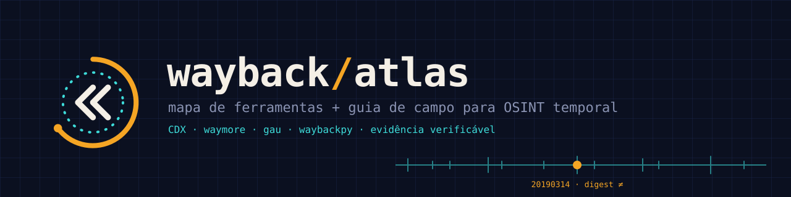

<div align="center">
  <picture>
    <source media="(prefers-color-scheme: light)" srcset="assets/banner-light.svg">
    
  </picture>
</div>

<p align="center">
  <b>Mapa</b> das melhores ferramentas da Wayback Machine · <b>Guia</b> de uso passo a passo · <b>Método</b> para transformar capturas em evidência
</p>

---

## Por que existe

A Wayback Machine é um arquivo de **observações**: ela diz *quando um rastreador viu algo*, não *quando algo foi publicado*. Este repositório junta, num lugar só:

1. **Um mapa** das ferramentas que consultam ou recuperam esse arquivo (CLI, bibliotecas Python, extensão, API).
2. **Um guia** com trilha de estudo, exercícios e receitas prontas.
3. **Um método** de cadeia de evidência e higiene analítica, porque em investigação digital o maior risco não é a ferramenta, é a conclusão apressada.

> **Transparência:** as ferramentas foram selecionadas pelas funcionalidades **documentadas**. Nenhuma foi executada na curadoria inicial (status `documentado` no [catálogo](docs/catalogo.md)). Os scripts em `scripts/` têm testes automatizados contra um servidor simulado; contra a Wayback real, valide no seu ambiente.

## Comece por aqui

Para OSINT, a combinação de partida é **CDX API + waymore + uma biblioteca Python**: descobrir URLs antigas, recuperar conteúdo e montar análise temporal.

| Se você quer… | Vá para |
|---|---|
| Entender o que a Wayback prova (e o que não prova) | [docs/01-fundamentos.md](docs/01-fundamentos.md) |
| Consultar o índice de capturas | [docs/02-cdx-api.md](docs/02-cdx-api.md) |
| Uma ordem de estudo | [docs/03-trilha-de-estudo.md](docs/03-trilha-de-estudo.md) |
| Praticar | [docs/04-exercicios.md](docs/04-exercicios.md) |
| Documentar achados com rigor | [docs/05-cadeia-de-evidencia.md](docs/05-cadeia-de-evidencia.md) |
| Evitar vieses que sabotam a investigação | [docs/06-psicologia-investigativa.md](docs/06-psicologia-investigativa.md) |
| Limites éticos e de OPSEC | [docs/07-etica-e-opsec.md](docs/07-etica-e-opsec.md) |

## Curadoria ampliada

**15 ferramentas e referências · 13 guias externos · 6 laboratórios avançados.**

| Próximo objetivo | Material |
|---|---|
| Escolher entre Wayback, captura local e outro acervo | [Ecossistema e preservação](docs/08-ecossistema-e-preservacao.md) |
| Praticar hipóteses, cronologia e comparação | [Laboratórios avançados](docs/09-laboratorios-avancados.md) |
| Resolver falhas de coleta e replay | [Diagnóstico e qualidade](docs/10-diagnostico-e-qualidade.md) |
| Registrar uma comparação reproduzível | [Ficha de comparação](templates/comparacao-temporal.md) |

Os oito recursos iniciais focam Wayback e descoberta de URLs; os sete adicionais cobrem preservação, replay, WARC e um acervo complementar. São referências documentais, sem incorporação de código externo.

## Mapa de repositórios

<!-- tools:begin -->
| Repositório | Para que serve | Avaliação |
|---|---|---|
| [xnl-h4ck3r/waymore](https://github.com/xnl-h4ck3r/waymore) | Descobre URLs em diferentes fontes e baixa respostas arquivadas da Wayback Machine. | **Primeira escolha para investigação exploratória: permite pesquisar o conteúdo recuperado, além de listar endereços.** |
| [tomnomnom/waybackurls](https://github.com/tomnomnom/waybackurls) | Recebe domínios e retorna URLs conhecidas pela Wayback, incluindo subdomínios. | **Melhor opção simples para pipelines: pequena e direta.** |
| [lc/gau](https://github.com/lc/gau) | Coleta URLs de Wayback, Common Crawl, OTX e URLScan; oferece filtros e saída JSON. | **Boa para ampliar cobertura.** |
| [akamhy/waybackpy](https://github.com/akamhy/waybackpy) | Biblioteca Python e CLI para Availability, CDX e Save Page Now. | **Boa porta de entrada para automação, com exemplos acessíveis.** |
| [edgi-govdata-archiving/wayback](https://github.com/edgi-govdata-archiving/wayback) | Cliente Python para pesquisar e recuperar capturas históricas, chamadas mementos. | **Candidata para pipelines de pesquisa temporal; documentação dedicada à busca e recuperação.** |
| [hartator/wayback-machine-downloader](https://github.com/hartator/wayback-machine-downloader) | Recupera arquivos arquivados, com filtros por período, URL e extensão. | **Útil para reconstrução local.** |
| [internetarchive/wayback-machine-webextension](https://github.com/internetarchive/wayback-machine-webextension) | Extensão oficial para salvar páginas e acessar capturas antigas e recentes. | **Melhor começo sem programação, especialmente durante pesquisa manual.** |
| [internetarchive/wayback — CDX Server](https://github.com/internetarchive/wayback/tree/master/wayback-cdx-server) | Código e documentação do serviço de consulta ao índice de capturas. | **Referência técnica essencial: ajuda a entender os dados que as outras ferramentas consultam.** |
| [webrecorder/pywb](https://github.com/webrecorder/pywb) | Reproduz e grava arquivos web em uma infraestrutura própria. | **Escolha para servir coleções WARC e estudar replay.** |
| [webrecorder/warcio](https://github.com/webrecorder/warcio) | Lê e escreve registros WARC e lê ARC em streaming. | **Útil para inspecionar metadados e extrair respostas de arquivos locais.** |
| [webrecorder/browsertrix-crawler](https://github.com/webrecorder/browsertrix-crawler) | Realiza captura com navegador em um contêiner Docker. | **Opção para capturas reproduzíveis de páginas que dependem de navegador.** |
| [webrecorder/archiveweb.page](https://github.com/webrecorder/archiveweb.page) | Grava navegação no navegador para construir um arquivo web. | **Útil em preservação manual de páginas interativas.** |
| [webrecorder/replayweb.page](https://github.com/webrecorder/replayweb.page) | Reproduz arquivos web diretamente no navegador. | **Bom para revisar e compartilhar coleções preservadas em formatos suportados.** |
| [ArchiveBox/ArchiveBox](https://github.com/ArchiveBox/ArchiveBox) | Organiza um arquivo próprio de URLs e salva conteúdo em múltiplos formatos. | **Útil para coleções de pesquisa e preservação recorrente.** |
| [arquivo/pwa-technologies](https://github.com/arquivo/pwa-technologies) | Documenta tecnologias e APIs do Arquivo.pt, incluindo pesquisa de arquivos web. | **Fonte complementar para comparar cobertura com a Wayback.** |
<!-- tools:end -->

Fichas completas e filtro por papel (descobrir, recuperar, analisar, preservar): [docs/catalogo.md](docs/catalogo.md). Dados-fonte: [`data/tools.json`](data/tools.json) — para adicionar uma ferramenta, edite o JSON e rode `make catalog`.

### Qual escolher?

```text
Sem programar, pesquisa manual ........ extensão oficial
Lista de URLs para um pipeline ........ waybackurls (simples) · gau (mais fontes)
Explorar e ler o conteúdo recuperado .. waymore
Automatizar em Python ................. waybackpy · wayback (EDGI)
Reconstruir um site localmente ........ wayback-machine-downloader (delimite o período!)
Entender o que está por baixo ......... CDX Server (referência)
```

## Trilha de estudo

<!-- guides:begin -->
| Ordem | Guia | O que aprender |
|---|---|---|
| 1 | [Using the Wayback Machine — Internet Archive](https://help.archive.org/help/using-the-wayback-machine/) | Navegação, capturas e limitações do arquivamento. |
| 2 | [Save Pages in the Wayback Machine](https://archivesupport.zendesk.com/hc/en-us/articles/360001513491-Save-Pages-in-the-Wayback-Machine) | Preservação de páginas com Save Page Now e extensões. |
| 3 | [Wayback Machine APIs — documentação oficial](https://archive.org/help/wayback_api.php) | Consulta programática de disponibilidade de capturas. |
| 4 | [CDX Server API — documentação oficial](https://github.com/internetarchive/wayback/tree/master/wayback-cdx-server) | Enumeração, datas, filtros, campos, deduplicação e paginação. |
| 5 | [Waybackpy — documentação](https://akamhy.github.io/waybackpy/) | Uso das APIs por Python e terminal. |
| 6 | [Wayback (EDGI) — documentação](https://wayback.readthedocs.io/en/stable/) | Pesquisa e recuperação de capturas em scripts. |
| 7 | [pywb — documentação](https://pywb.readthedocs.io/en/latest/) | Coleções locais, reprodução e gravação de arquivos web. |
| 8 | [warcio — guia do mantenedor](https://github.com/webrecorder/warcio) | Registros WARC/ARC, cabeçalhos e leitura em streaming. |
| 9 | [Browsertrix Crawler — guia do projeto](https://github.com/webrecorder/browsertrix-crawler) | Captura automatizada com navegador e Docker. |
| 10 | [ArchiveWeb.page — guia do projeto](https://github.com/webrecorder/archiveweb.page) | Preservação manual de navegação. |
| 11 | [ReplayWeb.page — documentação](https://replayweb.page/docs/) | Abrir e revisar arquivos web no navegador. |
| 12 | [Arquivo.pt — APIs](https://github.com/arquivo/pwa-technologies/wiki/APIs) | Pesquisa complementar em outro acervo. |
| 13 | [ArchiveBox — documentação](https://docs.archivebox.io/latest/) | Organização e configuração de um arquivo próprio. |
<!-- guides:end -->

Material do Internet Archive ou dos próprios mantenedores. Versão comentada em [docs/03-trilha-de-estudo.md](docs/03-trilha-de-estudo.md).

## Três exemplos para começar

**1. Consultar o índice de uma página, preservando datas e metadados**

```bash
curl -G 'https://web.archive.org/cdx/search/cdx' \
  --data-urlencode 'url=example.com/pagina' \
  --data 'output=json' \
  --data 'fl=timestamp,original,statuscode,mimetype,digest'
```

Mantenha todas as capturas no primeiro passe: deduplicar cedo pode esconder repetições relevantes.

**2. Listar URLs históricas de um domínio**

```bash
go install github.com/tomnomnom/waybackurls@latest
printf '%s\n' 'example.com' | waybackurls > urls.txt
```

**3. Usar o `gau` só com a Wayback (procedência clara)**

```bash
go install github.com/lc/gau/v2/cmd/gau@latest
gau --providers wayback --subs --o urls-wayback.txt example.com
```

## Scripts incluídos

Somente biblioteca padrão do Python (3.9+), sem dependências.

```bash
# 1. índice de capturas -> CSV + proveniência (.meta.json com query, hora UTC e SHA-256)
python scripts/wb_cdx.py example.com/pagina --out out/pagina.csv

# 2. cronologia em Markdown com pontos de mudança (digest / status HTTP)
python scripts/wb_timeline.py out/pagina.csv > out/pagina-timeline.md

# 3. comparar duas capturas (conteúdo bruto, modificador id_)
python scripts/wb_diff.py https://example.com/pagina 20200101000000 20220101000000
```

| Script | Faz | Cuidado embutido |
|---|---|---|
| [`wb_cdx.py`](scripts/wb_cdx.py) | Consulta a CDX com paginação por `resumeKey`, retry com backoff | Grava a URL exata consultada e o SHA-256 do resultado |
| [`wb_timeline.py`](scripts/wb_timeline.py) | Resume capturas por ano, status e mudanças | Lembra que a 1ª captura não é a data de publicação |
| [`wb_diff.py`](scripts/wb_diff.py) | Diff entre duas capturas | Usa `id_` (sem banner nem links reescritos) e registra hashes |

## O cuidado analítico mais importante

**A primeira captura encontrada não determina a data de publicação.** Ela documenta uma observação arquivada; a página pode ter existido antes. Páginas e recursos podem estar incompletos ou vir de capturas diferentes. Inspecione conteúdo e timestamps antes de afirmar quando algo surgiu ou mudou.

## Quatro exercícios

**recuperar uma página removida → inventariar URLs de um domínio → comparar versões → produzir uma linha do tempo com evidências.** Esse caminho ensina mais do que instalar várias ferramentas que fazem a mesma coleta. Roteiros completos em [docs/04-exercicios.md](docs/04-exercicios.md).

## Estrutura do repositório

```text
.
├── README.md                 ← você está aqui
├── assets/                   ← identidade visual (logos, banners, tokens)
├── data/tools.json           ← fonte única do mapeamento de ferramentas
├── docs/                     ← guia: fundamentos → CDX → trilha → exercícios → evidência → psicologia → ética
├── scripts/                  ← wb_cdx · wb_timeline · wb_diff · build_catalog
├── templates/                ← ficha de evidência e relatório de cronologia
├── tests/                    ← testes (servidor Wayback simulado)
└── .github/                  ← CI, templates de issue e PR
```

Identidade visual e uso dos assets: [docs/identidade-visual.md](docs/identidade-visual.md). Contribuições: [CONTRIBUTING.md](CONTRIBUTING.md). Licença: [MIT](LICENSE).
