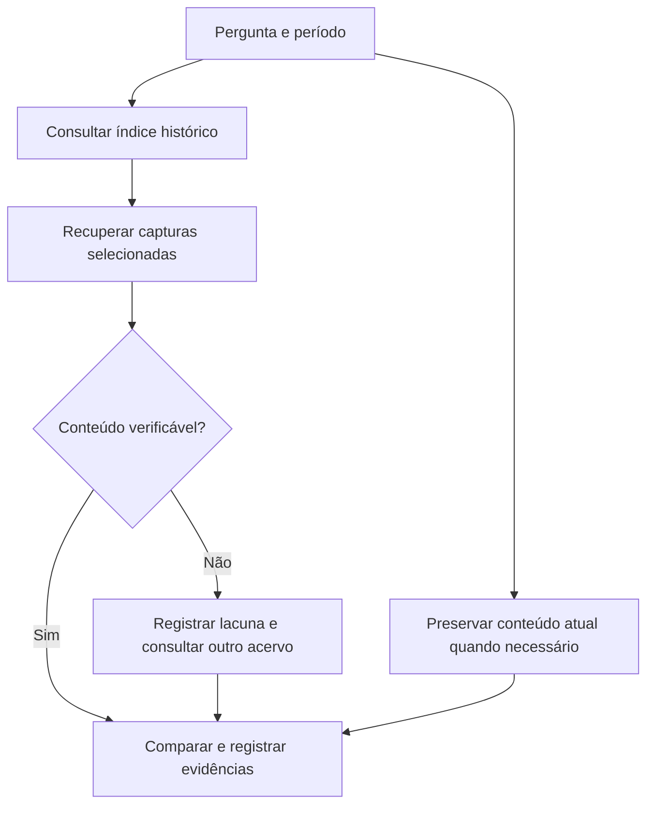

# 08 · Da captura histórica ao arquivo de pesquisa

[Início](../README.md) · [Catálogo](catalogo.md) · [Laboratórios](09-laboratorios-avancados.md)

Curadoria documental: 2026-10-19. Os recursos abaixo foram consultados em suas fontes primárias; não foram executados nesta ampliação. Inclusão não representa auditoria de segurança, licença ou manutenção.

## Escolha pela pergunta

| Pergunta | Recurso | Entrega e limite |
|---|---|---|
| Quais URLs já foram observadas? | CDX, waybackurls, gau | Inventário; não comprova disponibilidade atual |
| Qual conteúdo foi arquivado? | waymore, wayback EDGI, waybackpy | Respostas históricas; pode haver falhas ou redirecionamentos |
| Como recuperar arquivos de um site? | wayback-machine-downloader | Arquivos disponíveis; versões podem ter datas diferentes |
| Como preservar uma navegação agora? | ArchiveWeb.page | Captura manual; depende dos estados visitados |
| Como repetir capturas com navegador? | Browsertrix Crawler | Captura automatizada; validar escopo e recursos |
| Como organizar minha coleção? | ArchiveBox | Coleção local; revisar integrações configuradas |
| Como reproduzir um arquivo? | ReplayWeb.page ou pywb | Reprodução do material disponível, não reconstrução de dados ausentes |
| Como inspecionar registros WARC? | warcio | Metadados e payloads; requer arquivo existente |
| Onde comparar cobertura? | Arquivo.pt | Acervo independente, com APIs e cobertura próprias |

**Recomendação editorial:** comece com CDX e análise manual. Acrescente uma ferramenta somente quando ela resolver uma etapa que falta no seu fluxo.

## Quatro objetos que não devem ser confundidos

- **Índice CDX:** metadados que ajudam a localizar capturas. Não contém a página completa.
- **HTML recuperado:** uma resposta; CSS, imagens e chamadas de API podem estar ausentes.
- **WARC:** registros de arquivamento que podem incluir respostas, requisições e metadados. O conteúdo depende de como foi produzido.
- **WACZ:** empacotamento de arquivos web com recursos voltados à distribuição e reprodução. Confira suporte na ferramenta escolhida.

Uma captura de tela é útil para explicar um achado, mas não substitui o conteúdo e os metadados usados na análise.

## Fluxo recomendado

Registre separadamente: horário da captura histórica, horário da recuperação atual e eventual horário de publicação declarado no documento. Uma declaração do próprio site é uma fonte a avaliar, não um relógio independente.

## Guia de preservação manual

1. Defina as URLs e interações necessárias antes de iniciar a gravação.
2. Em ArchiveWeb.page, grave a navegação e visite os estados relevantes.
3. Exporte o arquivo no formato suportado e registre versão da ferramenta e horário UTC.
4. Abra o arquivo em um reprodutor compatível, como ReplayWeb.page.
5. Verifique texto, imagens, navegação e estados interativos; anote o que falhou.
6. Calcule SHA-256 do arquivo entregue e guarde uma cópia original sem alterações.

**Limite:** preservar hoje não cria uma captura histórica. O hash permite verificar se o arquivo mudou após a coleta; não comprova que as afirmações da página são verdadeiras.

## Fontes primárias e aprofundamento

- [pywb](https://github.com/webrecorder/pywb) e [manual](https://pywb.readthedocs.io/en/latest/): coleções e replay.
- [warcio](https://github.com/webrecorder/warcio): leitura e escrita de WARC e leitura de ARC.
- [Browsertrix Crawler](https://github.com/webrecorder/browsertrix-crawler): captura em contêiner; [Browsertrix](https://github.com/webrecorder/browsertrix) é a plataforma de gestão relacionada.
- [ArchiveWeb.page](https://github.com/webrecorder/archiveweb.page): captura no navegador.
- [ReplayWeb.page](https://replayweb.page/docs/): revisão de arquivos preservados.
- [ArchiveBox](https://docs.archivebox.io/latest/): organização de coleções e configuração.
- [Arquivo.pt APIs](https://github.com/arquivo/pwa-technologies/wiki/APIs): pesquisa em acervo complementar.

As licenças dos projetos de terceiros não são substituídas pela licença deste repositório. Consulte cada licença antes de incorporar ou redistribuir código.
